# Window session

`Sources/CatWM/Session/` saves and opens app windows. It does not know about CatWM workspaces, layouts or Desktops. It has no CatWM types, such as `WindowManager`, `WorkspaceModel`, `Layout`, `Theme` or `HUD`, and `Tools/check-style.sh` rejects these names in it. The code in `Sources/CatWM/Templates/` uses `Session/` and changes the CatWM state.

## Folder map

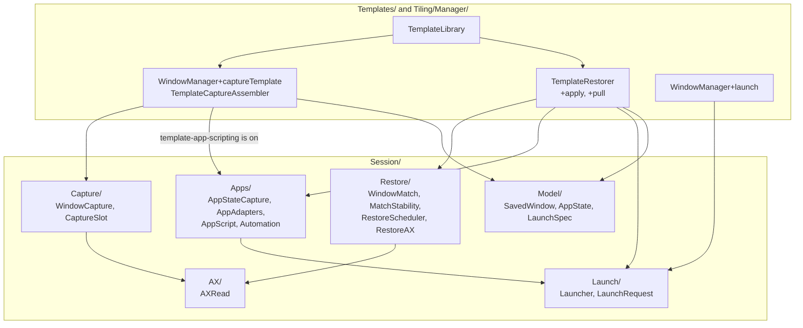

## Saved data

`WorkspaceTemplate` stays in the app. Its `SavedWindow` is the `Session/` type. The `state` and `launch` fields are optional, so an old `templates.json` file loads without a change.

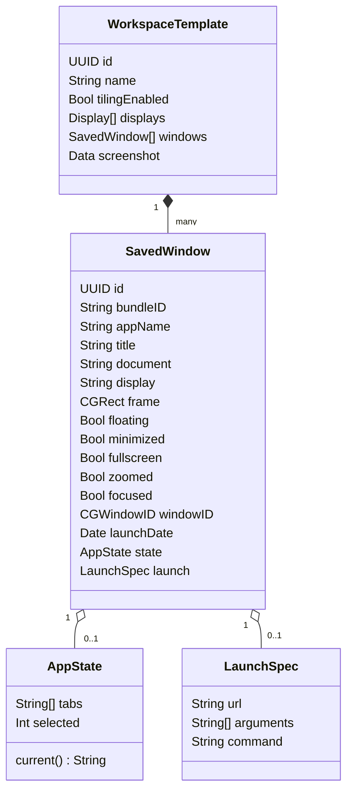

`AppState.tabs` holds one URL for each tab. A browser tab is an `http` or `https` URL. A Terminal tab, an iTerm2 tab or a Finder tab is a `file` URL of a folder. A code editor window has one `file` URL: its project folder, `.code-workspace` file, Xcode project or `Package.swift`.

## Save a template

The AX read has a budget of 2 seconds, with a backstop of 2.6 seconds. The app state step runs only when `template-app-scripting` is on. It runs after the AX read, so it cannot make the AX read time out.

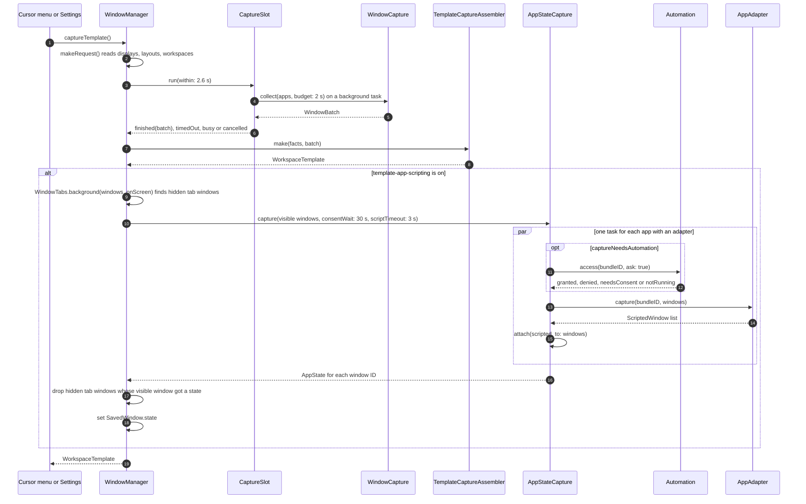

### Background tabs

macOS gives each native tab (Terminal, Finder, TextEdit) its own AX window. Only the selected tab is on screen. A hidden window of an app with an adapter is a background tab when an on-screen window of the same app has the same frame (within 1 point). The adapter saves all tabs in the state of the visible window, so the hidden tab windows are removed from the template. If the visible window gets no state, for example because Automation is off, CatWM keeps the hidden windows.

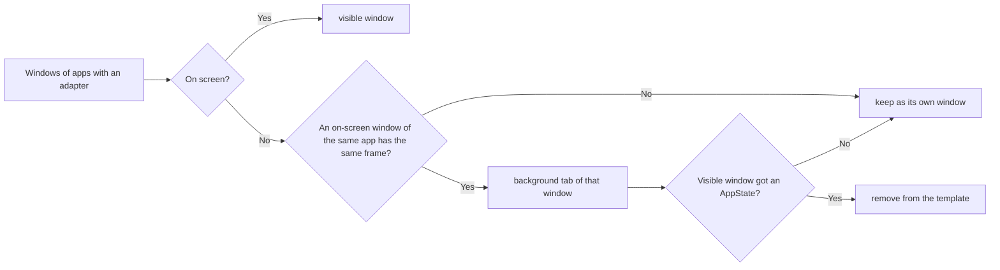

Finder scripting lists each tab as a Finder window. `WindowTabs.merged` joins the scripted windows that have the same frame into one state, in front-to-back order, so the front tab is the selected tab.

### Pair a scripted window with an AX window

A script gives a title and a frame for each window. It does not give a `CGWindowID`. `AppStateCapture.attach` finds the pairs. It sorts all pairs by cost and takes the lowest cost first. Each window and each scripted window is used one time.

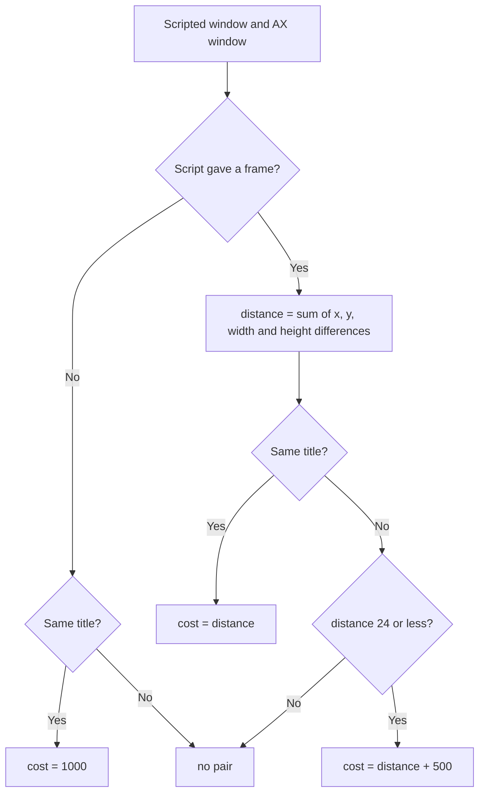

## App adapters

An adapter reads the state of one app and opens it again. For scripted apps, JavaScript for Automation (JXA) reads the state and returns JSON, and AppleScript or a file opens it again. The code editor adapters need no script and no Automation: they read the editor's own recent-project data with `SQLiteRead` (read-only), and they get the AX title, frame and document of each window to choose the project. `AppScript` runs each script in an `osascript` process. A timer stops the process at the timeout, so an app that does not respond cannot stop CatWM.

```mermaid
classDiagram
    class AppAdapter {
        <<protocol>>
        Set~String~ bundleIDs
        Bool captureNeedsAutomation
        Bool restoreNeedsAutomation
        capture(bundleID, windows, timeout) ScriptedWindow[]
        restore(state, bundleID, appURL, timeout) Bool
    }
    class SafariAdapter {
        capture: JXA window tabs and current tab
        restore: AppleScript new document and tabs
    }
    class ChromiumAdapter {
        Chrome, Brave, Edge, Vivaldi, Helium
        capture: JXA tabs, skips incognito
        restore: AppleScript new window and tabs
    }
    class TerminalAdapter {
        capture: JXA tab tty, then WorkingDirectory
        restore: one tab opens its folder, more tabs open a temporary window group file
    }
    class ITermAdapter {
        capture: JXA session tty, then WorkingDirectory
        restore: AppleScript new window, tabs and cd
    }
    class FinderAdapter {
        capture: JXA target folder of each tab, merged by frame
        restore: open the selected folder with Finder
    }
    class CodeEditorAdapter {
        VS Code, Insiders, Cursor, VSCodium, Windsurf
        capture: recent folders and workspaces in state.vscdb
        restore: open the project with the editor
    }
    class ZedAdapter {
        capture: workspaces.paths in the Zed db
        restore: open the project with Zed
    }
    class XcodeAdapter {
        capture: walk up from AXDocument to a project
        restore: open the project with Xcode
    }
    AppAdapter <|.. SafariAdapter
    AppAdapter <|.. ChromiumAdapter
    AppAdapter <|.. TerminalAdapter
    AppAdapter <|.. ITermAdapter
    AppAdapter <|.. FinderAdapter
    AppAdapter <|.. CodeEditorAdapter
    AppAdapter <|.. ZedAdapter
    AppAdapter <|.. XcodeAdapter
    AppAdapters --> AppAdapter : finds by bundle ID
```

### Code editor projects

`ProjectGuess.pick` first limits the recent-project list to projects named in the window title. If no project is named, it uses the whole list. The open file then distinguishes projects with the same name. This keeps a recent nested folder from replacing the parent project that the window has open.

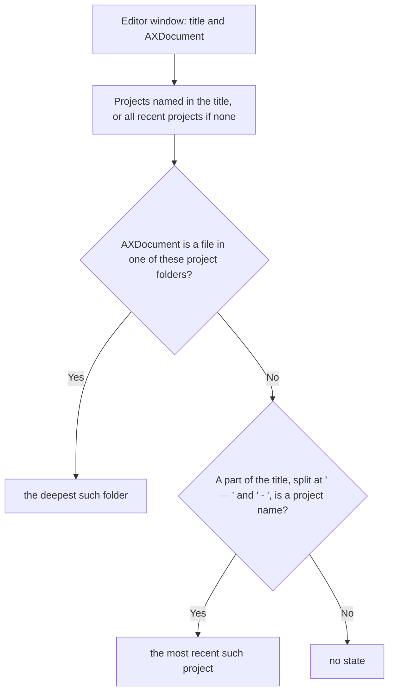

Xcode has no recent list that CatWM reads. `ProjectGuess.xcodeProject` walks up from the AXDocument file, at most 12 folders and not past the home folder, to the first folder with an `.xcworkspace`, an `.xcodeproj` or a `Package.swift`.

### Terminal tabs

Terminal scripting has no command that makes a tab. For a window with more than one tab, `TerminalGroup.file` writes a temporary window group file (`type = Window Group`, `WindowList`, a `Window Settings` array with `Tab Working Directory URL` and `TabSelected` for each tab), and CatWM opens it with Terminal. Terminal opens one window with all the tabs. The file is deleted after 30 seconds. The tab profile is the Terminal default profile.

`WorkingDirectory` finds the folder of a terminal tab without a script. It reads the device of the tty, finds the foreground process group of that tty with `sysctl`, and reads the current folder of that process with `proc_pidinfo`.

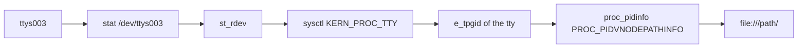

### Automation access

`Automation.access` calls `AEDeterminePermissionToAutomateTarget`. That call can wait for the user, so `Blocking.run` runs it on a background queue and returns a fallback at the timeout.

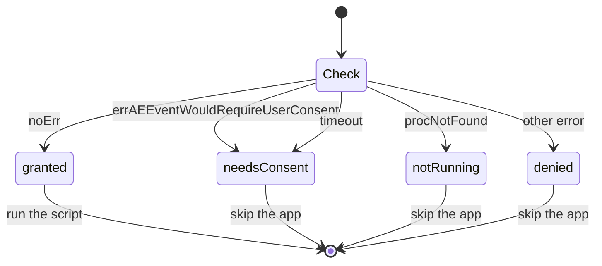

A save asks the user (`ask: true`). An open never asks (`ask: false`). If an adapter needs Automation and the app does not allow it, the open uses the next way in the list below.

## Open a template

`TemplateRestorer.restore()` has two phases. `discover()` finds or opens a window for each saved window. `apply()` selects the destination Desktops and interprets the saved display layouts and frames.

Tiling owns placement. `WindowManager.registerPlacements` applies the display layouts, registers the windows and computes tiled frames. `placeWindows` writes and checks the frames through the existing window backend and Animator. `PlacementHolds` suspends hidden windows until a newer scan confirms that they are visible. Templates retain the restore sequence and app-specific failure messages.

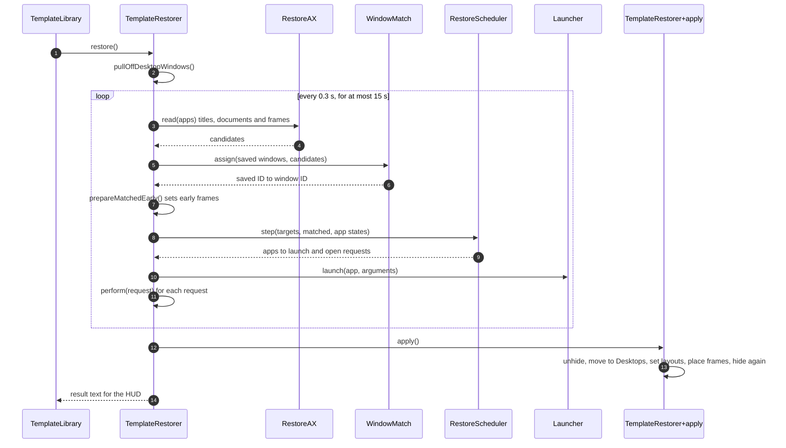

### One request

Each request opens one saved window. `perform` uses the first way that applies.

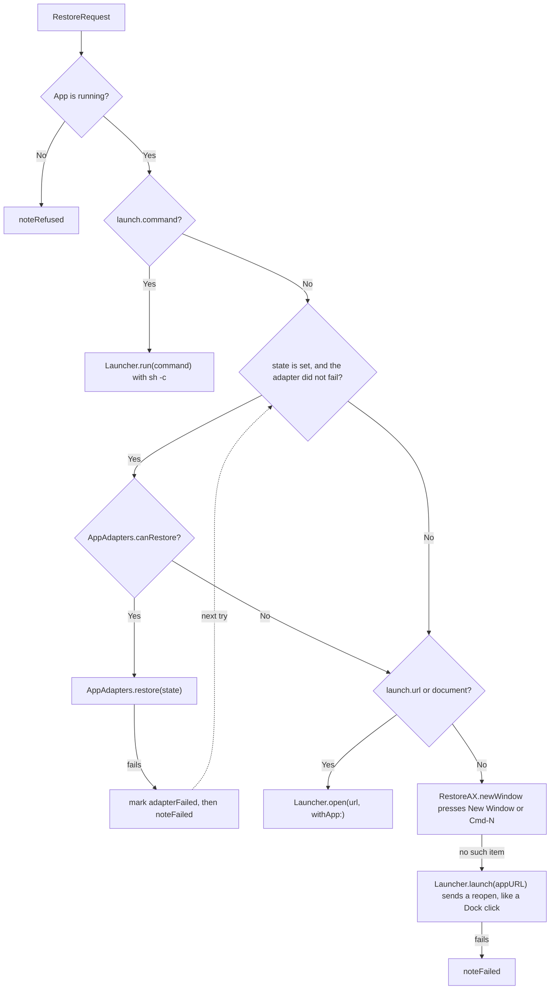

Some apps, such as Electron apps, have no "New Window" item and no Cmd-N. For these apps, CatWM sends a reopen request to the running app, without bringing it to the front. This is the same request that a Dock click sends, and the app makes a window. The request then stays pending until the window appears.

A failed request can try again after 0.5 seconds. It can try 3 times. A started command or a started open does not try again, so a slow app does not get two windows.

### Scheduler phases for one app

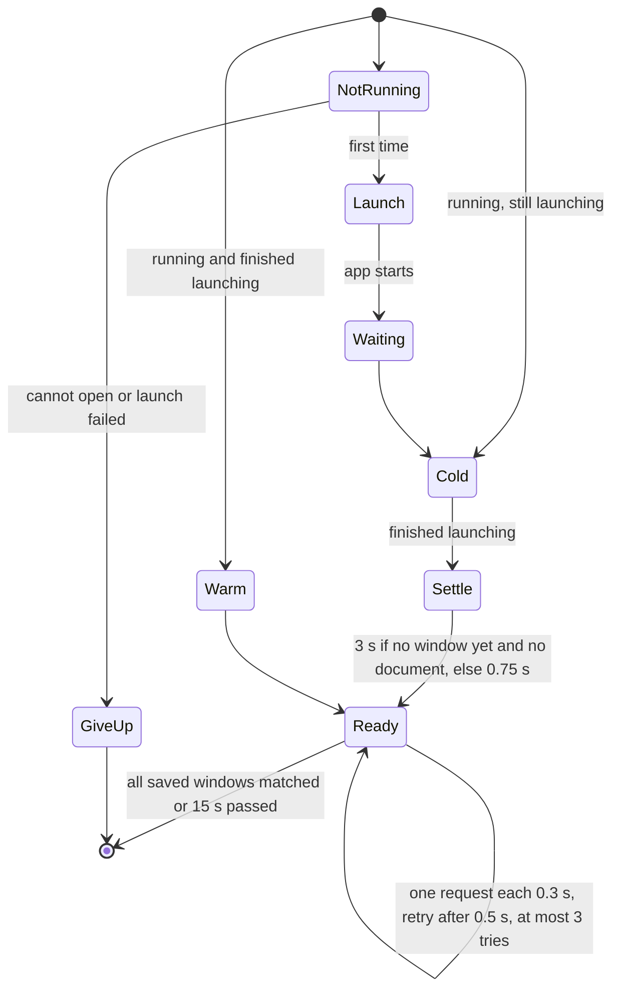

The 3-second wait lets an app bring back its own windows (macOS Resume) before CatWM opens new ones. `WindowMatch` then pairs those windows with the saved windows.

### Match windows

`WindowMatch.assign` runs in four rounds, from the best score to the lowest. In each round it sorts all pairs that fit. A pair with a nearer frame comes first. If two pairs have the same distance, the saved window that was made first gets the window that was made first.

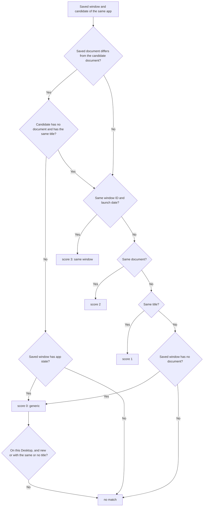

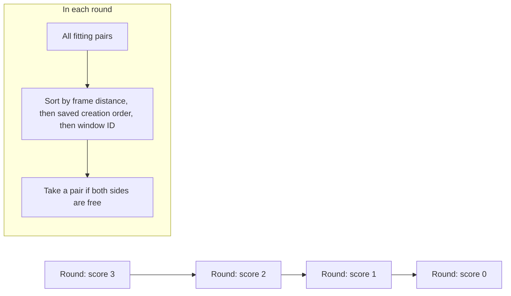

An existing window with a different document cannot match at score 0, even when its title matches. This keeps restore from reusing an unrelated browser window instead of opening the saved tabs.

A window that a script opened can show another URL while it loads. A saved window with app state can therefore match a new window at score 0. `MatchStability` waits until a score 0 or score 1 match stays the same for 0.6 seconds, but not more than 2 seconds. It ignores frame changes, so an early frame write does not restart the wait.

## The launch dispatcher

`bind = $mod, T, launch, Terminal workspace=2 frame=0,0,50%,100%`

`LaunchRequest` reads the options from the end of the argument. A word with `=` that is not `workspace`, `display` or `frame` stays in the target, so a URL with a query works. The CLI cannot run `launch`, because it can open a `.command` file.

An app name is looked up as `Name.app` in `/Applications`, `/System/Applications`, their `Utilities` folders, `~/Applications`, `/System/Library/CoreServices` (Finder) and `/System/Library/CoreServices/Applications` (Archive Utility, Keychain Access).

`Launcher.resolve` accepts URLs with a scheme, including `mailto:hello@example.com`, `tel:+4712345678` and `obsidian:open?vault=Work`. A URL does not need `//` after the scheme.

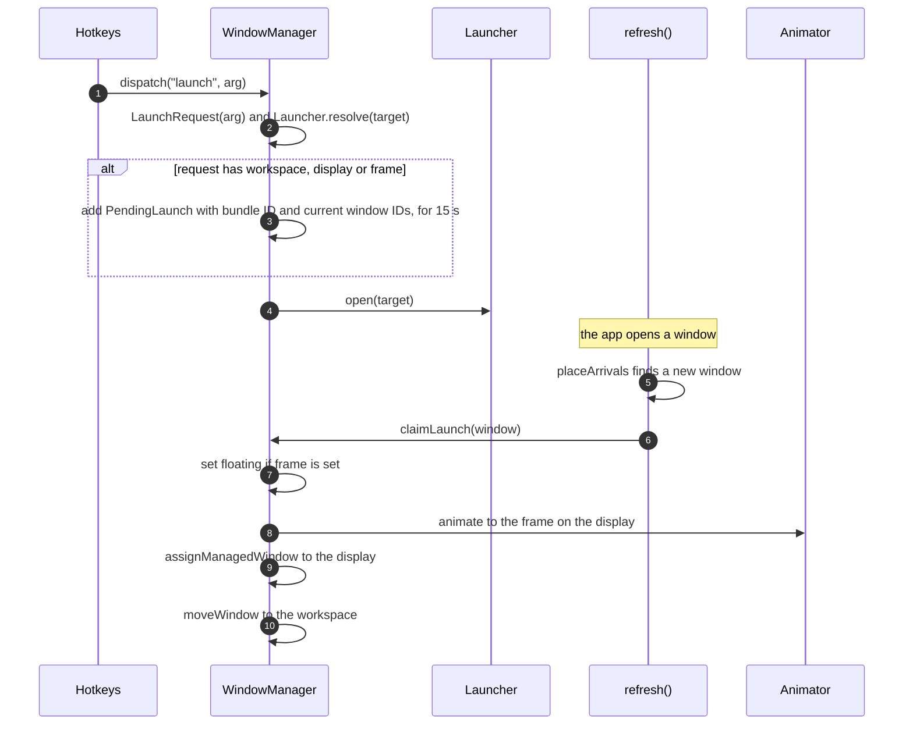

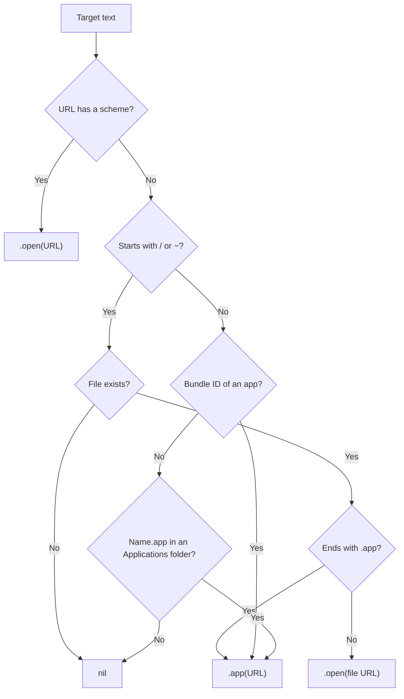
